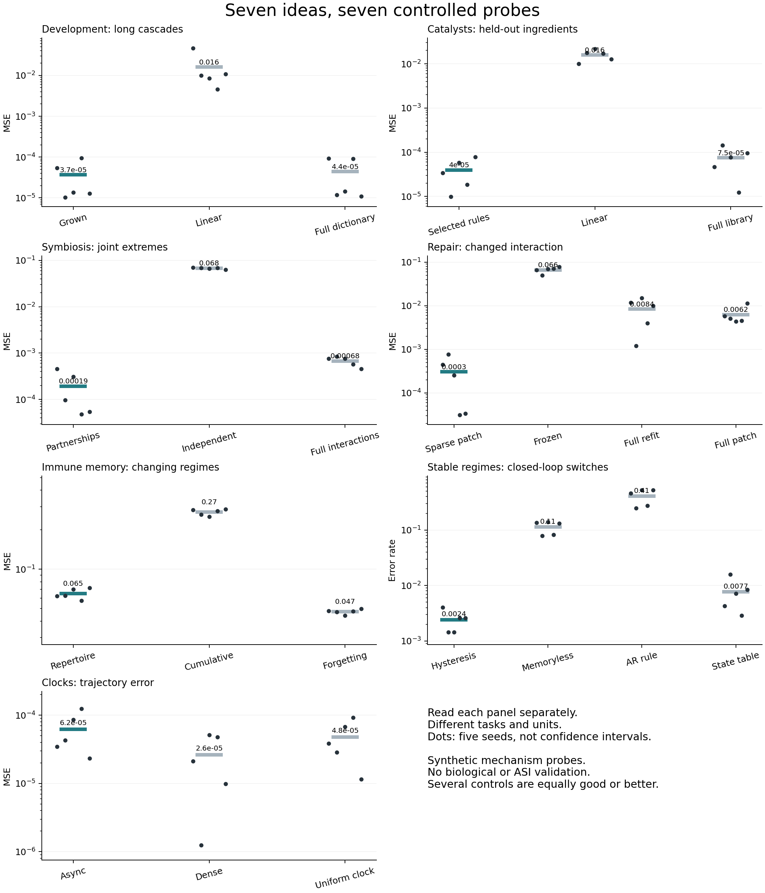

# Seven nature-inspired mechanism probes

Generated 2026-10-19T16:32:40.118914+00:00.

**Status:** Initial staged study complete.

Evaluate claims against the code and saved measurements.

These are seven small algorithmic abstractions, not seven finished general machine learning architectures. All data are synthetic. No novelty, biology, or ASI claim is validated by these results.

Each task has its own scale and controls. The table is descriptive, not a cross-task leaderboard. Repeated verification runs are not additional independent seeds.

| Probe | Prototype error, mean ± sample SD | Strong same-task comparison | Interpretation |
|---|---|---|---|
| Development: long cascades | 3.6952e-05 ± 3.67e-05 | Full dictionary: 4.449e-05 ± 4.39e-05 | Transfers across depth, but no reliable advantage over the fixed nonlinear dictionary. |
| Catalysts: held-out ingredients | 3.9687e-05 ± 2.81e-05 | Full library: 7.5106e-05 ± 4.97e-05 | Sparse rule selection helps on a supplied, correctly specified chemistry; rule recovery is imperfect. |
| Symbiosis: joint extremes | 0.00019197 ± 0.000181 | Full interactions: 0.0006763 ± 0.000157 | Two useful joins are retained on a composition-friendly synthetic task; stronger tuning remains needed. |
| Repair: changed interaction | 0.00030464 ± 0.000307 | Full patch: 0.0062363 ± 0.00294 | Sparse repair helps when the generating change is sparse and already in the dictionary. |
| Immune memory: changing regimes | 0.06491 ± 0.00591 | Forgetting: 0.047358 ± 0.00203 | Negative against forgetting regression, both overall and immediately after returns. |
| Stable regimes: closed-loop switches | 0.0024219 ± 0.00108 | State table: 0.0077083 ± 0.00502 | The matched hysteresis prior works; a generic state transition table is already competitive. |
| Clocks: trajectory error | 6.2143e-05 ± 4.2e-05 | Dense: 2.6254e-05 ± 2.24e-05 | Fewer updates than dense evaluation, but no error advantage over a similar-budget uniform clock. |

## What deserves follow-up

Repair and compact composition are the clearest positive mechanism demonstrations in this first pass, but both benefit from supplied operation families. They need fresh task families and tuned controls before guiding an architecture decision.

The immune repertoire and asynchronous allocation both fail against meaningful controls. Those results are retained rather than tuned away after evaluation.

For clocks, mean per-seed dense/asynchronous update ratio is 3.44. This is an event-count ratio, not a measured wall-time speedup; the similar-budget uniform clock is more accurate on average.

## Limits

- Several generators exactly match the supplied hypothesis class.
- Five seeds are an exploratory check, not a powered significance study.
- Parameter counts and tuning budgets are not fully equalized.
- Sparse algebraic programs, threshold fitting, and simple online rules are intentionally small proxies for the brainstormed ideas.
- Real molecular data, learned primitives, and broader transfer remain untested.

## Result provenance

- `01_development`: `results/01_development_20261019T163232557255Z/metrics.json`; source `61390eed7d13649520db37d796d8766cfe60fc91`.
- `02_catalysts`: `results/02_catalysts_20261019T163234450210Z/metrics.json`; source `61390eed7d13649520db37d796d8766cfe60fc91`.
- `03_symbiosis`: `results/03_symbiosis_20261019T163234599299Z/metrics.json`; source `61390eed7d13649520db37d796d8766cfe60fc91`.
- `04_repair`: `results/04_repair_20261019T163234772516Z/metrics.json`; source `61390eed7d13649520db37d796d8766cfe60fc91`.
- `05_immune_memory`: `results/05_immune_memory_20261019T163234909762Z/metrics.json`; source `61390eed7d13649520db37d796d8766cfe60fc91`.
- `06_stable_regimes`: `results/06_stable_regimes_20261019T163235870282Z/metrics.json`; source `61390eed7d13649520db37d796d8766cfe60fc91`.
- `07_clocks`: `results/07_clocks_20261019T163236191443Z/metrics.json`; source `61390eed7d13649520db37d796d8766cfe60fc91`.
