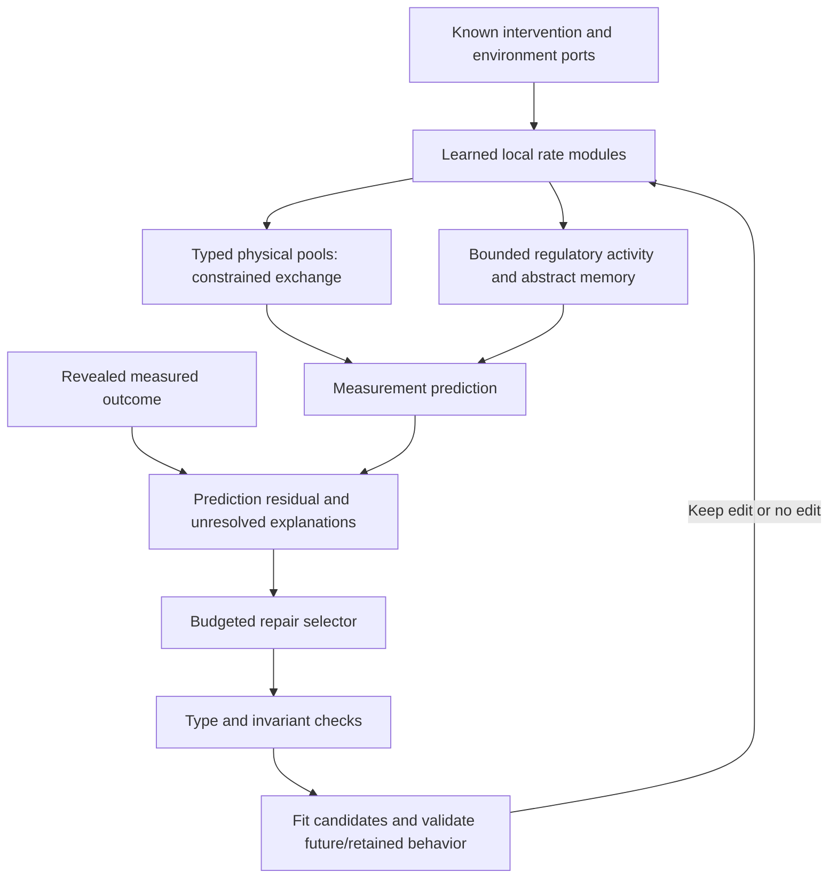

# Architecture decision after the nature-dynamics research round

**Date:** October 15, 2026. **Decision:** pursue a **typed reaction-and-repair substrate** as the next research architecture. This is the best justified direction from this round, not a validated best architecture or an established new category of machine learning. Its full structural-repair capability is not implemented.

**Later follow-up:** [RESEARCH_PROGRESS.md](RESEARCH_PROGRESS.md) reports the now-implemented limited coupled solver and nonlearned legal repair pilot. The constrained neural rate head wins the fixed-model comparison, and legal edit selection shows no broad advantage over budget-matched parameter adaptation. The [context/retention correction](CONTEXT_AND_RETENTION.md) supersedes the earlier build sequence before selector learning. The [specific closed-loop audit](CLOSED_LOOP_PRECEDENTS.md) also identifies closer predecessors for the overall vision. The proposal below records the earlier reasoning and is not a claim that the new studies succeeded.

## Why the recommendation changed

The first prototype treated all state coordinates as bounded computational compartments. That is useful for an engineering pilot, but it conflates measured amounts, regulatory activities, unmeasured environmental context, and abstract memory. Nature imposes different rules on these quantities. A representation should preserve a known closed-pool total when appropriate, allow known boundary flow in an open system, and avoid assigning fictitious molecular meaning to a hidden computational unit.

The biological sources in [BIOLOGICAL_RULES.md](BIOLOGICAL_RULES.md) motivate state competition, finite capacities, feedback, contextual interactions, and conditional repair. The [novelty audit](NOVELTY_AUDIT.md) shows substantial prior art for all these individual ingredients. The possible contribution is a precisely defined learned repair procedure over physically typed modules, under explicit measurement and retention budgets. That joint contribution remains a hypothesis.

## Minimal architecture

Use one model with three distinct state roles, not a collection of biological metaphors:

1. **Physical pools x:** nonnegative measured amounts with specified units and known pool constraints, when the application supplies them. For the implemented one-for-one closed exchange case, the conservative solver preserves total amount. General biochemical stoichiometry, growing volumes, feeds, and removal require additional operators; do not infer these from an arbitrary latent vector.
2. **Regulatory state h:** bounded activity variables with learned reaction-like rate laws. Retain the original gate substrate as the simple structural-repair research starting point; use competing-state rates as an ablation until stronger evidence justifies replacing it. Shared context/load variables belong here only with an explicit measurement or identifiability assumption.
3. **Abstract memory z:** computational state for missing history or unresolved context, with no physical mass assigned. Its biological interpretation is generally non-identifiable. In version zero these are the four hidden bounded states; more elaborate memory is deferred.

Known interventions u enter through named ports. A prediction module uses a fixed graph and learned parameters during its forecast. An observation module maps measured variables to the corresponding state roles and keeps missing measurements distinct from observed zeros. The present code only supports fully observed noiseless synthetic trajectories; the observation interface is a design requirement, not an implemented real-data capability.

A future coupled step would compute nonnegative rates from (x,h,z,u), advance each physical pool using a valid physical operator, then advance regulatory/memory states with their specified bounded dynamics. Validate the coupled discretization and all chain-rule terms; separately tested components do not automatically form a correct end-to-end solver.

## The structural operation worth investigating

After a measured failure, propose a limited change to the dynamics program. The action set includes parameter retuning, a new allowed interaction, a new abstract context/memory state, observation recalibration, or no edit. Each candidate must pass a type/invariant check before fitting. For example, adding a legal exchange edge preserves the known pool total; adding an abstract memory variable does not consume or manufacture measured pool content.

Fit no more than four candidates from the same proposal set and charge every fit, simulation, and measurement. Select on independent adaptation validation and retained-task probes. The proposed transferable element is a repair-selection policy trained across systems, not merely reoptimizing one set of rates. Whether such a policy helps is untested. Observation recalibration and active measurement are proposed extensions and must not be presented as currently functioning features.

This is structurally adapted world-model research. The closest methods include constrained reaction learning, context-adaptive dynamics, sparse regime-change discovery, and expandable models. They must receive the same information and budget in any serious claim of improvement.

## What the new experiments support

This round adds 27 generated family/system cases across three development studies and 486 training trials. They remain within three familiar synthetic function families. The seeds were fresh, but the families have repeatedly guided design; this is not a confirmatory cross-family result.

- Increasing the update budget substantially improves the original gate model. Some favorable comparisons appear at 960 updates, especially for the matched saturating family.
- Polarized activation/inhibition initialization is not a consistent fix. The exact half-mixing cancellation is real, but it is not established as the dominant performance bottleneck.
- The competing-state candidate has useful results on some conditions and failures on others. Do not promote it solely because the molecular analogy is attractive.
- Equal-wall-time comparisons change the ranking. A fixed number of gradient updates is not equivalent computation across these implementations.
- Matching the validation horizon to the long forecast improves each model's family-mean error in the paired follow-up. It uses more validation measurements and is not an architectural innovation.
- Closed exchange preserves its declared total and positivity, with checked derivatives. This is a known numerical construction and a component-level result, not better end-to-end learning or a novel mathematical theorem.

See [the consolidated research report](RESEARCH_RESULTS.md) for every table, individual outcomes, source commits, costs, and limitations. No method dominates all comparisons. No new world benchmark, 95% accuracy, biological sequence-generation performance, or ASI claim is supported.

## Concrete next scientific task

Focus the eventual typed-model test on **resource-coupled switch responses**: when one regulated output changes, predict whether a second changes through direct regulation or competition for a shared limiting pool. This is relevant to the original gene on/off interest and to documented cellular resource effects.

Start with a transparent simulator that can separately generate direct regulation, resource-mediated coupling, both mechanisms, noise-only variation, and no change. Make a known conserved pool available only in conditions where it truly exists. Keep the exact structure labels hidden from the learner. Evaluate discriminating interventions on independent trajectories, not observational correlations alone. A matched simulator is an engineering experiment and must be identified as such.

Compare the typed repair procedure with: parameter-only updates, the same model with nonlearned/random edit selection, a constrained generic rate model, context adaptation, and sparse equation repair. Use identical observations, invariant information, candidate budgets, and tuning resources. Include a diagnostic oracle only if it is clearly labeled privileged. Predefine a result that would reject the need for structural editing.

The first new claim to seek is narrow: fewer new measurements or less total repair cost to regain forecast quality while preserving justified constraints and retained tasks. A result must survive fresh mechanism families and actual experimental data before making broader biological claims.

## Build order and decision gates

1. Specify and implement the coupled typed solver and its measurement interface for this one task. Verify units, invariants, numerical convergence, and complete gradients.
2. Establish fixed-model and parameter-only controls using deployment-length validation. If physical typing supplies no useful benefit against an equally constrained control, narrow or drop the architecture claim.
3. Add nonlearned structural edit selection. If no structural advantage exists, do not train a selector merely to make the architecture more elaborate.
4. Only then train repair selection across separate systems. Require a win over the same candidates with random/nonlearned ranking at the same search cost.
5. Freeze and test unseen mechanisms, then select a suitable public experimental dataset with a separate biological protocol.

## Independent review and ASI

A [independent technical critique prompt](TECHNICAL_REVIEW.md) is prepared. No review has been submitted and no agreement is claimed. Its role would be to challenge the biology, mathematical assumptions, and remaining novelty distinctions; another model's endorsement would not replace evidence.

An ASI system would require capabilities far beyond this experiment. We are building a falsifiable architecture research program, not a verified path to superintelligence. There is no need to fabricate randomness or abandon mathematical tools to respect biological complexity. Missing observations and uncertain mechanisms must be represented and tested, not explained away with a nature analogy.
