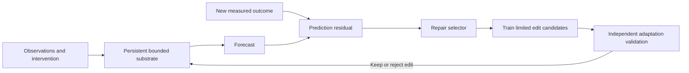

# Repair-driven development

**Latest status: October 15, 2026 follow-up complete.** Start with [RESEARCH_PROGRESS.md](RESEARCH_PROGRESS.md). A limited coupled typed solver and nonlearned legal-edge repair search are now implemented and tested in 333 additional training trials. The earlier round had 486 development fits. Learned repair selection, active experiments, and biological validation remain unimplemented.

The [specific closed-loop audit](CLOSED_LOOP_PRECEDENTS.md) finds close precedents for the overall idea, including a demonstrated 2019 signaling/metabolic revision loop. The [coupled-model pilot](TYPED_RESOURCE_RESULTS.md) favors the conventional constrained neural head; the [legal-repair pilot](TYPED_REPAIR_RESULTS.md) finds no broad advantage over parameter adaptation. [Context and retention](CONTEXT_AND_RETENTION.md) now need a precise interface before the learned-selector stage.

The earlier [architecture decision](ARCHITECTURE_DECISION.md) and [research results](RESEARCH_RESULTS.md) explain the **typed reaction-and-repair substrate** hypothesis. Read the [biological evidence](BIOLOGICAL_RULES.md), [focused novelty audit](NOVELTY_AUDIT.md), and optional [Claude Science critique prompt](CLAUDE_SCIENCE_REVIEW.md). No external review has been run. The original proposal below records the starting hypothesis; the latest progress and context correction supersede it where they differ.

Start with [the first-task implementation and pilot protocol](FIRST_TASK.md). Results are linked there after execution.

Keep this work in Nature Compute Lab. The seven initial experiments are mechanism probes; this is a proposal for a single model to build after those checkpoints. It does not replace or publish the pending experiments.

## The decision

Build a **Developmental Repair Substrate (DRS)**: a persistent collection of bounded computational compartments whose interactions are learned, and whose structure can grow or be repaired when feedback exposes a consequential prediction failure.

A scientist's first task for it would be narrow: observe a changing, partially measured dynamical system, forecast its response to a known intervention, and adapt after a mechanism changes using a limited number of new measurements. Start with abstract simulated regulatory systems. Sequence generation and protein design are later, separate research problems.

The central question is:

> Can a model learn where to change its computation, and spend fewer new observations and less computation recovering from an unfamiliar system change than a comparably resourced fixed model?

This is the best next research bet among our probes, not a demonstrated best architecture or a claim of priority.

## Why this idea

The first repair probe achieved mean MSE approximately 0.000305 versus 0.00624 for a regularized full patch. However, the generator changed one interaction and that interaction was already supplied in the learner's dictionary. This is encouraging evidence for a sparse-change prior, not evidence of an unrestricted repair ability. Development and composition supply possible building blocks; they have not demonstrated that combining them helps.

| Earlier idea | What we actually learned | Decision for the next architecture |
|---|---|---|
| Development | Repeated local rules transferred across cascade depth; a full fixed dictionary was competitive. | Test structural growth as a separate, removable mechanism. |
| Catalysts | Selecting a few supplied interactions helped on a matched generator. | Replace the correct-answer dictionary with trainable bounded interactions. |
| Symbiosis | Two useful compositions were retained on a favorable synthetic task. | Allow simple composition, but defer autonomous module societies. |
| Repair | Small corrections helped when the true change was sparse and in the dictionary. | Make recovery after a mechanism change the main research question. |
| Immune memory | Lost to forgetting regression. | Do not include repertoire memory in version one. |
| Stable regimes | Matched hysteresis worked on a hysteretic generator. | Treat switching and hysteresis as evaluation conditions, not evidence of general intelligence. |
| Independent clocks | No error advantage over a similar-budget uniform clock. | Use a common integration step in version one. |

These experiments have different tasks and scales. Their errors are not a shared leaderboard. The local comparison preview records the original measurements and limitations. Five exploratory seeds do not establish a reliable ranking.

## The nature analogy and its limit

Regeneration suggests three useful design questions: how does a system detect missing function, where does it act, and when does it stop rebuilding? Experimental work on regeneration shows that a wound signal's consequences depend on tissue context; this motivates context-dependent repair rather than unconditional growth. [Owlarn et al., 2017](https://www.nature.com/articles/s41467-017-02338-x).

Biological adaptation also motivates separating fast activity from slower corrective change. Integral-feedback studies provide concrete examples of robust adaptation under stated conditions. They do not prove that a learning architecture will acquire intelligence. [Yi et al., 2000](https://doi.org/10.1073/pnas.97.9.4649).

The proposed computational compartments are mathematical state variables. They are not neurons, real cells, or a biological reconstruction. The analogy suggests a mechanism to test; measured results must justify keeping it.

## What makes this an architecture proposal

DRS specifies a computational unit, a state-transition rule, a wiring representation, a parameter-learning procedure, a structural-edit procedure, and resource limits. The structure can change during an authorized adaptation phase; prediction runs with a frozen structure unless new feedback is available.

Trainable local interactions are the first representational hypothesis. A learned choice between rate adjustment, adding an interaction, adding a hidden compartment, pruning, or doing nothing is the structural hypothesis. The evaluation must distinguish these contributions.

Version zero fits one substrate per system and transfers the repair selector across systems. It is not yet a single pretrained model spanning biological entities. This scope keeps the first transfer claim testable.

The equations use familiar tools from dynamical systems, optimization, and model selection. Giving these tools biological names would not establish novelty. The candidate contribution is the precisely specified combination and the transferable repair behavior, if either survives comparison. The initial proposal omitted closest AI precedents at the user's request. During the subsequent research round, the user authorized both biology-led exploration and a focused comparison; [that audit](NOVELTY_AUDIT.md) finds substantial overlap and leaves the exact joint contribution unverified.

## What to build first

1. **Fixed substrate:** implement the bounded update in [SPEC.md](SPEC.md), fit parameters, and verify long rollouts. No structural edits yet.
2. **Hand-specified repair:** compare limited structural edits against parameter-only adaptation. This tests whether topology changes help before training a repair selector.
3. **Learned repair selection:** train on separate families of damage episodes. Measure whether it transfers beyond those families and beats a random-edit selector given the same search budget.
4. **Confirmatory comparison:** freeze code and tuning, then run [EVALUATION.md](EVALUATION.md). Keep dense-change and misspecified-family failures in the results.
5. **Biological transfer:** choose one suitably licensed experimental perturbation dataset, define a biologically defensible split, and test whether any synthetic benefit survives. Observational prediction alone will not establish causality.

Each step is its own checkpoint. The user requested the first fixed-substrate implementation and test on October 15; its source and results will be added to the existing draft PR. No new recurring publication schedule is created. The existing three scheduled checkpoints remain unchanged.

## Success and stopping

Use adaptation error, new-measurement requirements, retention, stability, and measured resource cost. There is no universal 95% accuracy target.

The provisional progression gate is at least a 10% relative reduction in adaptation error against the strongest validation-selected control on two of three confirmatory families, with a paired uncertainty interval excluding zero in both. Also require no more than 5% relative deterioration on retained tasks, the declared resource limits, and a measured benefit from the learned selector over its random and nonlearned controls. The evaluation document defines these conditions; they are research decisions, not predicted outcomes.

If a fixed model matches DRS, keep the simpler model. If only sparse, matched generators favor DRS, report a specialized inductive bias. If structural changes help but learned selection does not, keep the structural result and drop the learned-selector claim.

## Relationship to the ASI goal

A successful DRS would be an adaptive dynamical predictor with a particular repair capability. It would not demonstrate artificial superintelligence, universal biological understanding, sequence-design reliability, or experimental validity. A route toward broader capability would require demonstrated transfer across tasks, scales, representations, and real measurements; no result here guarantees that route will succeed.

The immediate deliverable worth pursuing is an explicit architecture and a decisive experiment, not an ASI label.
