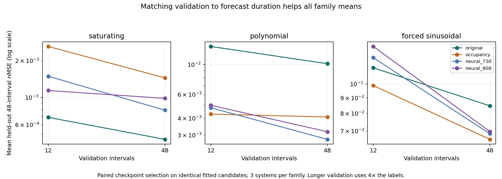

# Nature-dynamics research: evidence and decision

**Research date:** October 15, 2026, America/Los_Angeles. Raw artifacts use UTC timestamps, which fall on October 16. **Decision:** continue toward a typed reaction-and-repair substrate, with structural repair treated as an untested hypothesis. No current model wins consistently. No biological or ASI capability has been demonstrated.

This round implements and tests a competing-state rate model, examines the original gate model's initialization and training budget, tests validation-horizon effects, and verifies a conservative exchange component. It adds **486 training trials across 27 generated family/system cases**. These are development studies within three familiar synthetic families, not an independent world benchmark. The earlier [fixed-substrate pilot](FIRST_TASK.md) remains a separate result.

## What we built

- **Original gate substrate:** 736 parameters, eight observed coordinates and four hidden states. Learned nonnegative production/decay rates drive a bounded update. Its fixed wiring does not discover arbitrary structure.
- **Polarized initialization:** the same model with activation/inhibition mixing initially nearer the extremes. At exactly half mixing, the gate factor is constant and has zero state derivative; this algebraic cancellation motivated a diagnostic, not a conclusion about the main bottleneck.
- **Competing-state rates:** 820 parameters, four active alternatives and one reference inactive alternative per compartment. Normalized occupancies compete for unit capacity and determine nonnegative production/decay rates. Learned generalized log-affinities are phenomenological, not literal molecular binding energies or stoichiometry. See [the biology rationale](BIOLOGICAL_RULES.md) and [the mathematical overlap audit](NOVELTY_AUDIT.md).
- **Conventional controls:** tanh rate networks with 730 or 808 parameters, the same observed/hidden dimensions and bounded integrator. Parameter counts are close, not identical; 808 brackets the new model more closely. Affine ridge forecasting is included in the first two studies.
- **Closed exchange component:** a separately verified implicit transport update with nonnegative state and exact total preservation up to numerical error. It is a known backward-Euler construction, restricted to one-for-one exchange. It is not yet coupled to the learned forecasting models. See [CONSERVATIVE_COMPONENT.md](CONSERVATIVE_COMPONENT.md).

The model derivatives are implemented explicitly in NumPy. Tests cover unrolled gradients, rate/state derivatives, boundedness, exchange conservation, positivity, convergence, and invalid inputs. No structural-edit selector, experimental-data interface, protein designer, or sequence model is implemented.

## Shared measurement and task definition

Each generated system supplies 32 training trajectories of eight observation intervals, eight validation trajectories, and 16 held-out trajectories of 48 intervals. The three generator families are saturating, polynomial, and externally forced sinusoidal dynamics. Observations are complete and noiseless, interventions are known, and all states lie in [0,1]. The generator uses a separate RK4 solver; the learned models use two 0.1 microsteps per observation interval. The generators are not fitted by supplying their exact equations to the learner.

The metric is the mean squared forecast error divided coordinatewise by training-target variance, floored at 0.0001. Lower is better. It is not a percentage accuracy or a precision score. Long-horizon forecasting is closed loop. Variance floors affect the metric, especially for nearly constant coordinates.

All candidate learning rates (0.003, 0.01, 0.03) and protocols were committed before each study. Selection uses validation data; held-out results are examined afterward. Later studies deliberately respond to earlier development findings using new seeds, so these studies cannot collectively be called a confirmatory evaluation. The same three families have informed design repeatedly.

## Study 1: initialization and update budget

The [frozen protocol](NATURE_DIAGNOSTIC.md) compares five models at 240 and 960 optimizer updates, three learning rates each: **270 fits**. Seeds are 401, 503, 601 in each family. Validation lasts 12 intervals, testing lasts 48. Source freeze: `7ba0402`.

At 960 updates, mean held-out nMSE is:

| Model | Saturating | Polynomial | Forced sinusoidal |
|---|---:|---:|---:|
| Original | 0.000554 | 0.012851 | 0.073865 |
| Polarized | 0.000559 | 0.013455 | 0.070357 |
| Competing-state | 0.001237 | 0.004554 | 0.116905 |
| Neural 730 | 0.001003 | 0.004548 | 0.094196 |
| Neural 808 | 0.001670 | 0.003685 | 0.120966 |

Increasing training helps the original model considerably. It beats Neural 730 on family means in two of three families at this update budget; it loses substantially on polynomial dynamics. Polarization is not a consistent improvement. The competing-state model has a promising low-budget forced result that does not persist at the longer budget with the same short validation horizon. These are narrow development outcomes; three systems per family do not establish robust superiority.

Equal updates do not imply equal compute. That motivates the next study rather than declaring a winner here.

## Study 2: equal elapsed-time budget

The [frozen protocol](WALLTIME_PROTOCOL.md) gives each learning-rate trial 1.5 seconds of training and validation on this machine, allowing the final operation to finish. Four models, three rates, nine fresh cases yield **108 fits**. Seeds: 701, 809, 907. Source freeze: `fab43d3`. Run with `OPENBLAS_NUM_THREADS=1`.

| Model | Saturating | Polynomial | Forced sinusoidal |
|---|---:|---:|---:|
| Original | 0.001334 | 0.018802 | **0.065100** |
| Competing-state | 0.000863 | 0.004931 | 0.091094 |
| Neural 730 | **0.000646** | **0.004745** | 0.092833 |
| Neural 808 | 0.000808 | 0.010047 | 0.129530 |
| Affine ridge | 0.006092 | 0.016213 | 0.066382 |

The faster rate networks perform many more updates. Actual updates, times, and validation traces are saved for every trial. Elapsed-time curriculum and validation every 20 updates mean faster models also receive more checkpoint-selection opportunities. This is an implementation-specific resource comparison, not an intrinsic algorithmic-complexity ranking. Machine load, timer resolution, and initialization overhead outside the timed fit limit reproducibility. The affine fit has a different closed-form procedure and is a reference rather than an equal-time training condition.

The ranking changes with budget definition. Validation at 12 intervals also sometimes ranks long-forecast candidates poorly. We test that directly next.

## Study 3: paired validation horizons

The [frozen protocol](HORIZON_PROTOCOL.md) trains identical candidates for two independent selection rules: choose the learning rate/checkpoint by the first 12 validation intervals, or by all 48. Both rules see the same candidate trajectory; training does not change. Four models, three rates, nine new cases yield **108 fits**. Seeds: 1009, 1103, 1201. Source freeze: `9ecf8a6`. Run with `OPENBLAS_NUM_THREADS=1`.

With validation matched to the 48-interval forecast, mean held-out error is:

| Model | Saturating | Polynomial | Forced sinusoidal |
|---|---:|---:|---:|
| Original | **0.000456** | 0.010155 | 0.084750 |
| Competing-state | 0.001449 | 0.004090 | **0.065711** |
| Neural 730 | 0.000789 | **0.002791** | 0.068573 |
| Neural 808 | 0.000986 | 0.003180 | 0.069742 |

Every one of the 12 model/family means and 31 of 36 individual model/system outcomes improve with longer validation. This uses **four times as many validation labels**, and does not establish a better architecture or a universal benefit for each individual system. It demonstrates that an evaluation choice was a material part of the earlier result. A short validation window is not an adequate substitute for checking the intended deployment horizon.

## Complete outcomes and artifact verification

[RESULT_TABLES.md](RESULT_TABLES.md) reports all conditions, including the 240-update results and both horizon selectors, as mean ± sample standard deviation across three systems. Standard deviations are not confidence intervals. Individual system outcomes, validation traces, times, learning rates, predictions, weights, and datasets are stored in the raw directories:

- [Update-budget study](../../results/nature_diagnostic_20261016T015441102245Z/metrics.json), with [source provenance](../../results/nature_diagnostic_20261016T015441102245Z/protocol.json).
- [Elapsed-time study](../../results/nature_walltime_20261016T020053486333Z/metrics.json), with [source provenance](../../results/nature_walltime_20261016T020053486333Z/protocol.json).
- [Horizon study](../../results/nature_horizon_20261016T020716259962Z/metrics.json), with [source provenance](../../results/nature_horizon_20261016T020716259962Z/protocol.json).

Run `OPENBLAS_NUM_THREADS=1 python3 summarize_nature_research.py` to verify and regenerate the tables, figure, and [verification record](artifact_verification.json). It checks the recorded source hashes against committed source, disjoint recorded initial states, training-derived variance, reloaded forecasts, recomputed errors, and validation selection minima. It verifies selected saved models, not a complete independent rerun of every discarded candidate fit. Original raw artifacts are retained.

No cases or failures were removed to improve a ranking. We do not pool unrelated family errors into a single headline win. The studies share generator families, finite synthetic samples, full observation, and no noise. They do not test learned structural repair, mechanism identification, uncertainty calibration, unseen biological families, wet-lab success, or real-world general intelligence.

## Research recommendation

The strongest next hypothesis is **measurement-limited structural repair over physically typed dynamics**. Keep measured pools, bounded regulation, and abstract memory distinct; permit only valid edits; test whether learned repair decisions regain forecast quality using fewer new measurements than equally informed controls. Start with resource-coupled switch responses, which connects to the original gene on/off interest while remaining narrow enough to falsify.

[ARCHITECTURE_DECISION.md](ARCHITECTURE_DECISION.md) gives the proposed computation, edit actions, next task, controls, and stopping gates. [BIOLOGICAL_RULES.md](BIOLOGICAL_RULES.md) separates biological evidence from engineering inference. [NOVELTY_AUDIT.md](NOVELTY_AUDIT.md) documents 13 close primary precedents: the ingredients are known, and the exact proposed joint contribution is not established as new.

A [Claude Science review prompt](CLAUDE_SCIENCE_REVIEW.md) is prepared but has not been submitted. No external-model agreement is claimed. We can proceed with the bounded next experiment without that optional review. The present work supports an executable research direction, not a verified route to ASI.
