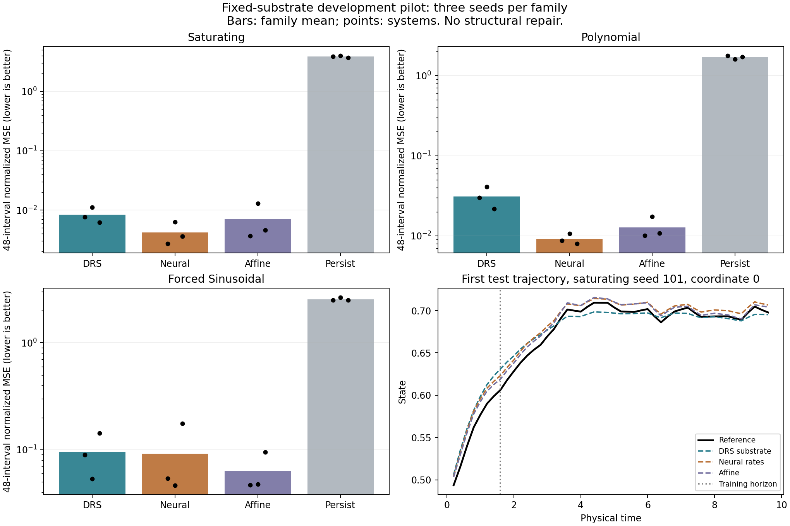

# Fixed-substrate pilot results

**Outcome:** the custom substrate learns bounded forecasts, but it has no demonstrated accuracy advantage over the controls. Structural repair and ASI claims have not been tested.

Source frozen at `ca1de2c0df4a615caece63602fa71d1fe6a9945b`; completed 2026-10-16T01:18:38.807118+00:00. These are UTC provenance times. See the saved protocol, source fingerprints, tuning traces, datasets, weights, and predictions in the parent directory.

## Held-out long-rollout error

Variance-normalized MSE over 48 intervals (9.6 time units), mean ± sample SD across three system seeds. Training rollouts extend to eight intervals (1.6 units); validation extends to 12. Lower is better. No confidence or significance claim is made.

| Family | DRS substrate | Neural rate control | Affine control | Persistence |
|---|---|---|---|---|
| saturating | 0.00836777 ± 0.00258 | 0.00419906 ± 0.00183 | 0.00703493 ± 0.00506 | 3.87107 ± 0.147 |
| polynomial | 0.0309235 ± 0.00955 | 0.00915807 ± 0.00136 | 0.0127864 ± 0.00409 | 1.68508 ± 0.0841 |
| forced sinusoidal | 0.0955157 ± 0.0451 | 0.0919719 ± 0.0725 | 0.0630488 ± 0.0275 | 2.55931 ± 0.0826 |

The neural rate control has lower family-mean error than DRS on all three families. The affine model has the lowest family mean on the forced-sinusoidal task. DRS beats the neural control in one of nine individual cases, but this does not establish a transferable advantage.

Both DRS and the neural control have 12 persistent states and the same bounded numerical update. They use 736 and 730 parameters respectively. They each receive three learning-rate trials, 240 optimizer updates per trial, identical observations, and the same validation selection procedure. The affine model is a much smaller, 88-parameter control with a one-step training objective and closed-loop evaluation. Equal trial budgets and parameters do not make training time or expressive power equal.

## Learning and numerical checks

| Family | Untrained DRS nMSE | Trained DRS nMSE | Reduction versus its initialization |
|---|---|---|---|
| saturating | 1.41052 | 0.00836777 | 99.41% |
| polynomial | 0.101806 | 0.0309235 | 69.63% |
| forced sinusoidal | 0.360191 | 0.0955157 | 73.48% |

- All nine selected substrates passed the finite/bounded 192-interval (38.4 time unit) diagnostic: **True**. This checks the repeated known input sequence; it is not an accuracy test or proof for all inputs.
- Learned-equation integration error decreased at every tested step halving on all nine cases: **True**. This does not imply better prediction of the true system.
- Maximum teacher RK4/adaptive-solver discrepancy: **3.35e-11** in state units.
- Six new tests passed, including parameter-gradient finite differences through complete rollouts, state-vector-Jacobian checks for both models, invalid inputs, resource caps, boundedness, and reference resolution. All 15 repository tests passed.
- The pilot source and configuration were committed before held-out scores were computed. Development smoke seed 13 was excluded from the reported cases.

## Measured training time

Sum of wall time across all three learning-rate trials for each of the nine systems, on the recorded machine. These exclude data generation, test forecasts, integration diagnostics, and reporting; they are not end-to-end or hardware-normalized benchmarks. Peak memory and energy were not instrumented.

- DRS substrate: 18.736 seconds.

- Neural rates: 2.640 seconds.

This NumPy implementation of DRS is also slower to train than the neural rate control. No speed advantage is claimed.

## Individual system results

| Family | Seed | DRS nMSE (12 / 48) | Neural nMSE (12 / 48) | Affine nMSE (12 / 48) |
|---|---|---|---|---|
| saturating | 101 | 0.00658162 / 0.00769738 | 0.00227793 / 0.0027222 | 0.00313544 / 0.00366532 |
| saturating | 211 | 0.00899342 / 0.0112183 | 0.00399499 / 0.00624734 | 0.012462 / 0.0128557 |
| saturating | 307 | 0.0062268 / 0.00618766 | 0.00188096 / 0.00362764 | 0.00351307 / 0.00458379 |
| polynomial | 101 | 0.0342189 / 0.030172 | 0.00933981 / 0.00878266 | 0.012999 / 0.0100868 |
| polynomial | 211 | 0.0275809 / 0.0408259 | 0.0079706 / 0.0106649 | 0.0117553 / 0.017495 |
| polynomial | 307 | 0.0248786 / 0.0217728 | 0.00610903 / 0.00802667 | 0.0116654 / 0.0107774 |
| forced_sinusoidal | 101 | 0.0790926 / 0.0898606 | 0.0552343 / 0.053846 | 0.0516863 / 0.046657 |
| forced_sinusoidal | 211 | 0.0771668 / 0.053542 | 0.0591527 / 0.0465068 | 0.0735472 / 0.047706 |
| forced_sinusoidal | 307 | 0.0888958 / 0.143144 | 0.0782565 / 0.175563 | 0.0792724 / 0.0947833 |

## Decision

The first engineering task is complete: differentiable gate dynamics, parameter fitting, deterministic reproducible forecasts, and numerical checks work. The architectural advantage is unproven, and the present evidence favors the controls for predictive accuracy.

Do not advance to real biology, claim 95% accuracy, or present this as ASI. Before adding structural repair, run a separate development-only diagnostic to separate limited gate expressivity, fixed wiring, and optimization budget. Candidate experiments should include a clearly labeled matched-wiring diagnostic and capacity/training-budget curves on fresh development seeds. Neither the diagnosis nor an improvement from it has been demonstrated by this run. Freeze the next protocol before computing new held-out results, keep this pilot intact, and do not relabel these seeds as confirmatory.
